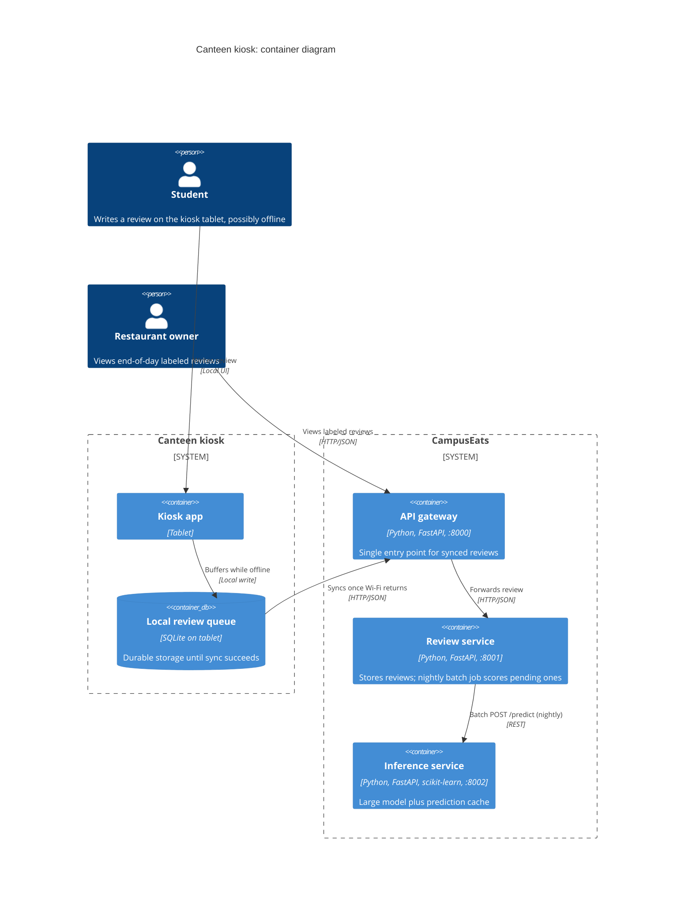

# Task 4: Deployment topologies and trade-offs

**Name / ชื่อ:** นฤเมศร์ พิทยจำรัส

**Student ID / รหัสนิสิต:** 6731328921

This is **individual work**: each student completes and submits their own copy, in their own fork.

*งานนี้เป็น**งานเดี่ยว** นิสิตแต่ละคนทำและส่งงานของตัวเอง ใน fork ของตัวเอง*

**Scenario (A, B or C) / Scenario ที่เลือก:** B. Canteen kiosk

Choose **one** scenario below. If the last digit of your student ID is odd, take A or B; if it is even, take B or C. Use your measurements from Tutorial 6 as evidence: cite run names from `results/runs.csv`. Answer in Thai or English.

เลือก scenario **หนึ่ง** ข้อด้านล่าง ถ้าเลขตัวสุดท้ายของรหัสนิสิตเป็นเลขคี่ ให้เลือก A หรือ B ถ้าเป็นเลขคู่ ให้เลือก B หรือ C ใช้ผลการวัดจาก tutorial ที่ทำไปเป็นข้อมูลอ้างอิง โดยอ้างชื่อ run จาก `results/runs.csv` จะตอบเป็นภาษาไทยหรือภาษาอังกฤษก็ได้

Facts that hold in every scenario / ข้อเท็จจริงที่ใช้กับทุก scenario:

- The large model serves at most **20 calls per second** (4 calls at once × about 200 ms each), and every call costs money.

  *large model รับได้สูงสุด **20 calls ต่อวินาที** (พร้อมกัน 4 calls × ประมาณ 200 ms ต่อ call) และทุก call มีค่าใช้จ่าย*
- The small model is fast and cheap enough to run anywhere, including inside the review service or on a kiosk, but it is much less accurate on its own.

  *small model เร็วและถูกพอที่จะรันที่ไหนก็ได้ รวมถึงภายใน review service หรือบน kiosk แต่ถ้าใช้ตัวเดียวจะแม่นน้อยกว่ามาก*

## Scenarios

**A. Owner alerts.** When a customer posts a negative review, the restaurant owner gets a push notification within **2 seconds**. At the lunch peak, CampusEats receives **40 reviews per second**. A missed alert is acceptable, but a wrong alert (for example, "your customer is unhappy" when they are happy) makes owners stop trusting alerts and, in the end, ignore them.

*เมื่อลูกค้าโพสต์รีวิวเชิงลบ เจ้าของร้านจะต้องได้รับ push notification ภายใน **2 วินาที** เวลาช่วงพีคตอนเที่ยง CampusEats ได้รับรีวิวจำนวน **40 รายการต่อวินาที** การพลาด alert ไปบ้างนั้นยอมรับได้ แต่ alert ที่ผิด (เช่น "ลูกค้าไม่พอใจ" ทั้งที่จริงๆ แล้วพอใจ) จะทำให้เจ้าของร้านไม่เชื่อถือและเลิกสนใจ alert ในที่สุด*

**B. Canteen kiosk.** A tablet in each canteen lets students leave a review on the spot. However, the canteen Wi-Fi is poor: the tablets lose their connection several times a day, for minutes at a time. The system must accept every review, even while a tablet is offline. Restaurant owners need the labels **by the end of the day**.

*มี tablet ในแต่ละโรงอาหารให้นิสิตรีวิวได้ทันที อย่างไรก็ดี การเชื่อมต่อ Wi-Fi ในโรงอาหารไม่ดี ทำให้ tablet หลุดการเชื่อมต่อวันละหลายครั้ง ครั้งละหลายนาที ระบบจะต้องรับรีวิวได้ทุกรายการแม้ขณะที่กำลัง offline อยู่ และเจ้าของร้านต้องการ label **ภายในสิ้นวัน***

**C. Weekly report.** Restaurant owners want a weekly sentiment report. Nothing in producing this report has to be real-time. **Accuracy matters most** and **cost must be minimal**.

*เจ้าของร้านต้องการรายงาน sentiment รายสัปดาห์ ไม่มีอะไรที่จะต้องทำแบบ real-time ในการออกรายงานนี้ ความแม่นยำ **(accuracy) สำคัญที่สุด** และ **ค่าใช้จ่ายต้องน้อยที่สุด***

## Topologies and patterns to choose from / Topology และ pattern ที่เลือกใช้ได้

| | Topology | Where the model runs / โมเดลรันที่ไหน |
|---|---|---|
| T1 | Model as a service, synchronous | Inference service, called for each review (today's baseline) *inference service ถูกเรียกทุกรีวิว (baseline ของวันนี้)* |
| T2 | Model as a library | Inside the review service, or on the device *ภายใน review service หรือบนอุปกรณ์* |
| T3 | Hybrid | Small model locally, large model as a remote service *small model รันในเครื่อง large model เป็น remote service* |
| T4 | Asynchronous / batch | Reviews are queued (broker, W10) or stored, and scored later in bulk *รีวิวถูกเข้าคิว (broker, W10) หรือเก็บไว้ แล้วติด label ทีหลังเป็นชุด* |

Combine one topology with any of the patterns from Tutorial 6: **fallback**, **cascade** and **cache**.

*เลือก topology หนึ่งแบบ แล้วผสมกับ pattern จาก Tutorial 6 ได้ตามต้องการ: **fallback**, **cascade** และ **cache***

## 1. Quality requirements

The three most important quality requirements for your scenario, each with a number where possible.

*quality requirements ที่สำคัญที่สุด 3 ข้อของ scenario ที่เลือก ระบุตัวเลขเมื่อทำได้*

| # | Quality | Requirement |
|---|---|---|
| 1 | Availability (offline tolerance) | The kiosk must accept and durably store every review even while Wi-Fi is down for minutes, several times a day, so nothing is lost either way. |
| 2 | Latency (relaxed) | No real-time requirement: labels only need to exist by the end of the day, unlike QR1's 1-second SLA on the main path. |
| 3 | Accuracy | Still needs QR3's 90% floor. Since there's no latency pressure, nothing forces a cheaper, less accurate model. |

## 2. Design / การออกแบบ

Your topology, the patterns you add, and a container-level diagram (C4 level 2). The C4 diagram must be written in Mermaid.

*topology ที่เลือก pattern ที่เพิ่ม และ diagram ระดับ container (C4 level 2) เขียนด้วย Mermaid*

Topology: **T4 Asynchronous/batch**, fed by a local buffer on the kiosk (a bit of T2, model-as-a-library thinking, applied to durable storage instead of the model itself) so the tablet can keep accepting reviews while offline.

Patterns added:
- **Fallback** (Task 1): if the nightly batch job can't reach the large model, affected reviews stay `pending` and retry on the next run, instead of blocking or dropping them.
- **Cache** (Task 3): common short reviews ("Delicious!", "Too salty") are served from cache during the batch run, cutting large-model calls without touching accuracy.
- No cascade: since there's no 1-second SLA to protect, the batch job can afford to send every non-cached review straight to the large model and get the full 93.5% accuracy, instead of trading accuracy for speed.

## 3. Evidence / หลักฐาน

Which runs support your choice? Show the numbers and, for scenario A, the capacity arithmetic: how many large-model calls per second does your design need at the peak?

*run ไหนที่สนับสนุนการตัดสินใจของนิสิต ให้นิสิตแสดงตัวเลขประกอบ และสำหรับ scenario A ให้นิสิตแสดงการคำนวณ capacity ด้วย เพื่อแสดงว่าในช่วงพีคนั้น design ของนิสิตต้องใช้ large model กี่ calls ต่อวินาที*

| Run | What it shows / แสดงอะไร |
|---|---|
| t1-after | Fallback keeps every review (0 errors, 17 pending instead of lost) when the large model can't answer in time. The kiosk design reuses this same safety net for the nightly batch run. |
| t0-large | Scoring everything with the large model alone reaches 93.5% accuracy, same floor as QR3. Affordable here because there's no latency SLA forcing a cascade threshold trade-off like CampusEats' real-time path needs. |
| t3-cache | Caching answers 35% of requests from cache and cuts large-model calls to 38%, lowering the nightly batch's compute cost for free, with no accuracy loss (93.0% accuracy, same ballpark as large-only). |

## 4. ADR

Use the ADR format from W5.

*ใช้รูปแบบ ADR จาก W5*

**Title:** Batch-score canteen kiosk reviews with local buffering, cache, and fallback

**Status:** Proposed

**Context:** Canteen Wi-Fi drops several times a day for minutes at a time, but the kiosk must never lose a review, and owners only need labels by the end of the day, not in real time.

**Decision:** Buffer reviews locally on the tablet while offline and sync them once connectivity returns. Score synced reviews with a nightly batch job (T4) that checks the cache first, then calls the large model directly for everything else, and falls back to `pending` for retry on the next run if the large model is briefly unavailable.

**Consequences:**
- Positive: no review is ever lost regardless of connectivity; accuracy stays at the large model's full 93.5% since there's no SLA forcing a cascade trade-off; caching cuts about a third of large-model calls for free.
- Negative: owners never see same-day feedback, since everything waits for the next batch window; the kiosk app needs its own local storage and sync logic; a multi-day outage could push a batch past the end-of-day deadline.

**Alternatives considered:** T1 (today's baseline, model as a service called synchronously per review). Rejected because it requires the tablet to be online for every single review, which breaks the core offline requirement outright.
